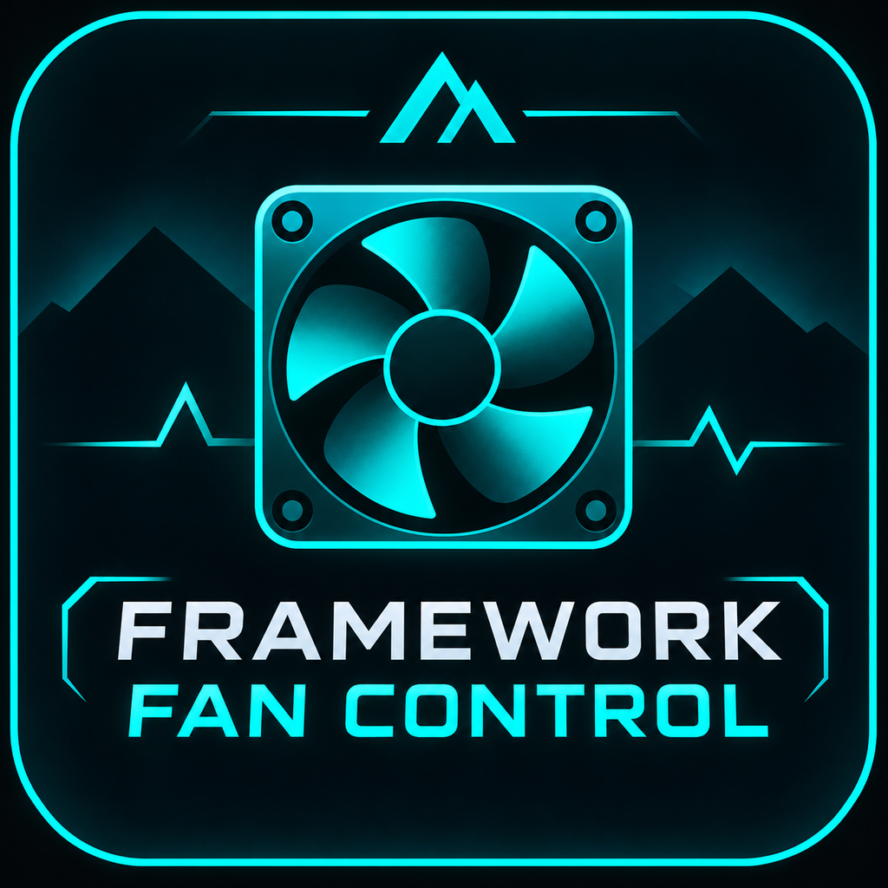
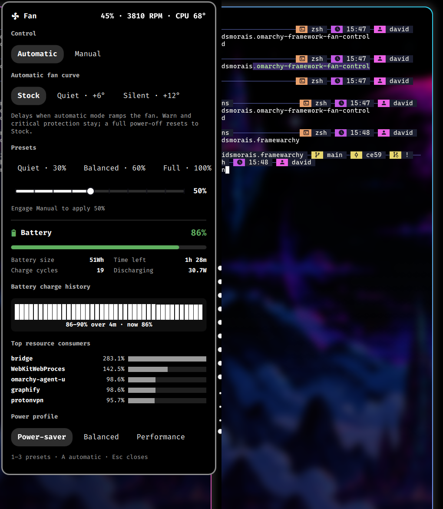
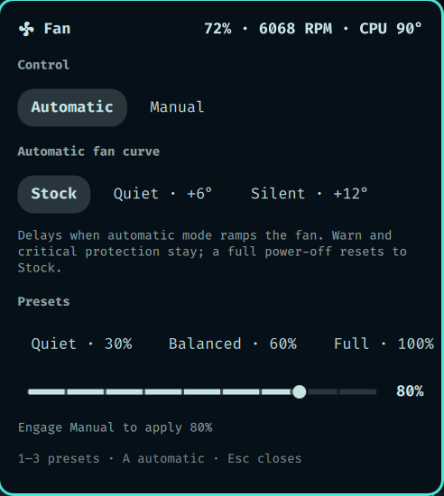
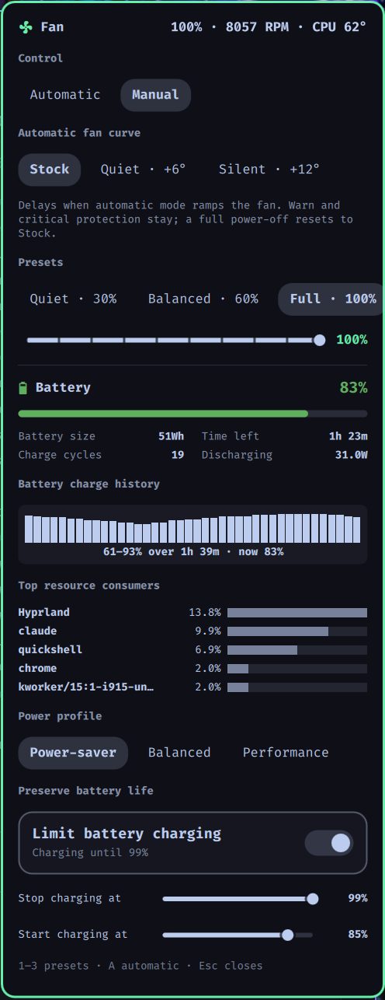

# Framewarchy for Omarchy

<p align="center"></p>

A bar widget for Framework laptops: the fan's RPM and the EC's CPU
temperature in the bar, and a popup that switches the fan between the
embedded controller's automatic control and a manual duty cycle.

## Screenshots



| Bar widget | Automatic | Manual |
| :---: | :---: | :---: |
|  |  |  |

## Features

- **Automatic / Manual** toggle, a 10–100 % slider (step 10), and three
  presets: Quiet 30 %, Balanced 60 %, Full 100 %.
- **Automatic fan curve** presets — Stock, Quiet (+6°), Silent (+12°) —
  that shift the EC's own ramp thresholds so automatic mode reacts later
  to load. Warn and critical thresholds are never touched, the battery
  sensor keeps its own protection, and a full power-off resets to Stock.
  The active curve is read back from the EC (`ectool thermalget`), so the
  widget shows what the EC is really running.
- The slider **stages** while automatic: moving it never touches the fan
  until Manual is engaged. Presets engage manual directly.
- Right-click the bar icon to restore automatic control immediately.
- **Battery** in the bar (icon + percentage, colored green / yellow / orange /
  red by level, accent while charging) and in the panel: capacity, time
  left, charge cycles, live power draw, a 48 h charge history, the top CPU
  consumers, and a Power-saver / Balanced / Performance profile switch
  (`powerprofilesctl`).
- **Preserve battery life**: a toggle that disables charging between two
  levels — *Stop charging at* (default 99 %) and *Start charging at*
  (default 85 %). Once the battery reaches the stop level charging stays off
  (`ectool chargecontrol idle`) until it drains to the start level. A root
  systemd timer (`omarchy-fanctl-charge.timer`, every 30 s) enforces it, so it
  works with the shell closed. Turning it off restores normal charging.
- Panel keys: `1`/`2`/`3` presets, `A` automatic, `Esc` closes.
- Monitoring (RPM, CPU temp, current mode) is read straight from hwmon
  sysfs and a world-readable state file — no process per reading.

## Why ectool

The Framework 13 EC exposes RPM and temperatures through the `cros_ec`
hwmon device, but **not** PWM control (`pwm1`/`pwm1_enable` are absent on
current kernels), so sysfs-based fan plugins cannot control this machine.
Duty is set through `ectool` (`fanduty` / `autofanctrl`) against the
root-only `/dev/cros_ec`.

## Requirements

- Omarchy with the manifest-based Quickshell plugin API
- A Framework laptop with a `cros_ec` hwmon fan
- `fw-ectool-git` (AUR) providing `/usr/bin/ectool`
- `sudo` and `visudo` (no `jq` or other helpers)

## Install

```bash
omarchy plugin add https://github.com/davidsmorais/framewarchy --yes
cd ~/.config/omarchy/plugins/io.github.davidsmorais.framewarchy
sudo ./setup install
omarchy plugin enable io.github.davidsmorais.framewarchy
omarchy bar move io.github.davidsmorais.framewarchy --section right
```

`setup install` copies the root-owned helper to
`/usr/local/libexec/omarchy-fanctl`, creates `/var/lib/omarchy-fanctl/`
(state, world-readable), installs a sudoers rule allowing **only**
`omarchy-fanctl auto`, `manual 10..100`, `curve …`, `charge off` and
`charge limit NN NN`, and installs a systemd suspend hook and the charge
timer. Nothing goes into `/usr/share/omarchy/`.

## Safety

- The sudoers whitelist is enumerated: `auto`, the eleven valid duties,
  `curve stock|quiet|silent`, `curves`, `charge off` and
  `charge limit NN NN` (two-digit percents, range-checked by the helper:
  stop 60–99, start 20..stop−1) — nothing else. The helper
  re-validates every value itself, so a bad value fails twice.
- Curve presets only shift each sensor's `fan_off`/`fan_max`; warn, high
  and halt stay at stock values, and the battery sensor is skipped.
- **Suspend:** the system-sleep hook returns the fan to automatic control
  before sleeping whenever a manual duty was active.
- **Reboot:** the EC forgets manual duties; the plugin compares the boot id
  in the state file and reports automatic. A full power-off also resets
  the curve to Stock.
- Manual 0 % is not offered — 10 % is the floor.
- Only one controller at a time: don't also run `fw-fanctrl` or engage the
  Max mode of another fan widget.

## Update

```bash
cd ~/.config/omarchy/plugins/io.github.davidsmorais.framewarchy
sudo ./setup install     # keeps the installed helper in sync
```

## Uninstall

```bash
cd ~/.config/omarchy/plugins/io.github.davidsmorais.framewarchy
sudo ./setup uninstall   # restores automatic control, removes every trace
omarchy plugin disable io.github.davidsmorais.framewarchy
omarchy plugin remove io.github.davidsmorais.framewarchy --yes
```

## Development

```bash
tests/run
```

`helper.test.sh` drives the helper against a fake sysfs tree and a fake
`ectool`; `model.test.js` runs Model.js under node, including markup-shaped
input cases for every value that reaches a tooltip or label.
